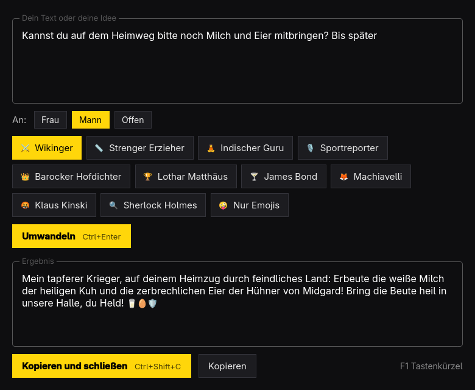

# Stilwandler



Schreibt eine Nachricht oder Idee maßlos übertrieben in einem Stil um, fertig zum Einfügen in Telegram, WhatsApp, Signal oder E-Mail. Omarchy-App (Qt Quick), folgt dem Theme, nutzt die Claude-API.

Stile: Wikinger, Strenger Erzieher, Indischer Guru, Sportreporter, Barocker Hofdichter, Lothar Matthäus, James Bond, Machiavelli, Klaus Kinski, Sherlock Holmes, Coder, Nur Emojis.

## Tastenkürzel

| Taste | Wirkung |
|---|---|
| Ctrl+Enter | Umwandeln (nochmal drücken = neue Variante) |
| Alt+1 … Alt+9 | Stil wählen (die ersten neun; die übrigen per Klick) |
| Alt+F / Alt+M / Alt+O | Empfänger: Frau / Mann / offen (Anreden wie Schildmaid statt Held) |
| Ctrl+Shift+C | Ergebnis kopieren und Fenster schließen |
| Esc | Abbrechen bzw. Fenster schließen |
| F1 | Tastenkürzel anzeigen |

Das Ergebnisfeld ist bearbeitbar, vor dem Kopieren lässt sich also noch nachbessern.

## Installation

Gedacht für [Omarchy](https://omarchy.org) (Arch Linux mit Hyprland). Auf anderem Arch Linux mit Wayland läuft es auch, folgt dann aber keinem Theme. Auf Omarchy sind alle Abhängigkeiten schon da; sonst vorher:

```
sudo pacman -S --needed base-devel git polkit qt6-base qt6-declarative qt6-wayland qt6-svg libsecret wl-clipboard
```

Dann im Terminal:

```
git clone https://github.com/bernhard2804/stilwandler.git
cd stilwandler
bin/install
```

`bin/install` baut ein Paket und installiert es (fragt per Dialog oder im Terminal nach dem Passwort). Danach steht „Stilwandler“ im App-Starter (Super+Leertaste). Aktualisieren: im Ordner `git pull` und wieder `bin/install`.

## API-Schlüssel

Die App braucht einen eigenen API-Schlüssel von Anthropic (https://platform.claude.com, „API Keys“; Umwandlungen werden über dieses Konto abgerechnet). Einmalig im Terminal in den Schlüsselbund legen; bei „Password:“ den Schlüssel `sk-ant-…` mit Ctrl+Shift+V einfügen (bleibt unsichtbar) und Enter drücken:

```
secret-tool store --label='Stilwandler' service stilwandler key anthropic
```

Alternativ liest die App die Umgebungsvariable `ANTHROPIC_API_KEY`.

## Tastenkürzel zum Öffnen (optional)

In `~/.config/hypr/bindings.lua` (eine freie Taste wählen, hier Super+Alt+X):

```lua
o.bind("SUPER + ALT + X", "Stilwandler", "omarchy-launch-or-focus '^stilwandler$' 'uwsm-app -- stilwandler'")
```

Als schwebendes Fenster in der Bildschirmmitte, in `~/.config/hypr/hyprland.lua`:

```lua
o.window("^stilwandler$", { float = true, size = { 780, 640 }, center = true })
```

## Eigene Stile

`~/.config/stilwandler/stile.json` ersetzt die eingebauten Stile, wenn vorhanden. Vorlage: `src/stile.json`. Je Stil `key` (a-z, 0-9, _), `name`, `emoji`, `short`, `description` und 2-3 `examples` (`original`/`result`, optional `to`: `frau` oder `mann`). Die Beschreibung nennt am besten Anreden für beide Richtungen. Beispiele treffen den Ton besser als jede Beschreibung. Ungültige Einträge werden übersprungen und im Fenster gemeldet.

## Einstellungen

`~/.config/stilwandler/stilwandler.conf` (Abschnitt `[General]`):
- `model=claude-opus-5-5` (Standard). `claude-haiku-5-5` ist deutlich günstiger, aber vermutlich weniger witzig.
- `effort=low` (schnell; `medium` denkt gründlicher, dauert länger).
- `style=` und `recipient=` merken sich den zuletzt gewählten Stil und Empfänger.

## Datenschutz und Kosten

- Der eingegebene Text geht an Anthropic. Die App speichert keine Texte, nur den zuletzt gewählten Stil und Empfänger.
- Mit Opus 5.5 und `effort=low` kostet eine Umwandlung etwa einen halben Cent.
- Kein Hintergrundprozess: Die App läuft nur, solange das Fenster offen ist. Die Zwischenablage hält danach `wl-copy`.

## Entwicklung

```
bin/build     # baut build/stilwandler
bin/test      # Tests, offscreen
bin/install   # Paket bauen und per pkexec installieren (erscheint im App-Starter)
```

Entfernen: `pkexec pacman -R stilwandler`.

## English

Stilwandler rewrites a message or idea in an absurdly exaggerated style (Viking saga, strict drill instructor, wise guru, sports commentator, baroque court poet, Lothar Matthäus, James Bond, Machiavelli, Klaus Kinski, Sherlock Holmes, coder, emojis only), ready to paste into any messenger or e-mail. Pick whether it goes to a woman, a man or anyone, and the forms of address follow. The styles are written for German messages; the model answers in the language you write in. The interface is German by default and English when Omarchy's language is set to English.

Install on Omarchy: `git clone https://github.com/bernhard2804/stilwandler.git && cd stilwandler && bin/install`. Store your own Anthropic API key with `secret-tool store --label='Stilwandler' service stilwandler key anthropic` (or set `ANTHROPIC_API_KEY`). Your text is sent to Anthropic; nothing is stored except your last choices.

## Lizenz

MIT, siehe `LICENSE`.
